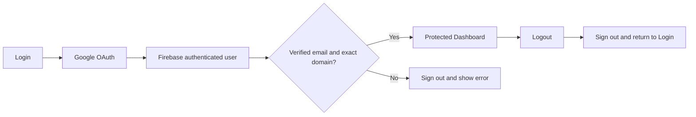

# Domain Auth

**React Native (Expo) + Web + Google OAuth + Firebase Authentication + exact email-domain restriction**

Domain Auth is a training assignment built from one React Native codebase. It provides Google login, a verified-email and domain check, a protected Dashboard, Logout, and responsive layouts for Web and Android. iOS is an intended Expo target, but native iOS authentication has **not** been configured or tested.

## What is implemented

| Feature | Status |
| --- | --- |
| Google sign-in through Firebase on Web and native Android | Implemented |
| Exact `@hbplus.fit` domain check and verified-email requirement | Implemented in source; matching-account login still untested |
| Protected Dashboard, session restoration, Logout, loading and error states | Implemented |
| Responsive Login and Dashboard | Implemented |
| Netlify single-page Web configuration and EAS Android build profiles | Implemented |
| Admin/User roles, database, analytics, backend | Not implemented; optional assignment bonuses |
| Native iOS authentication | Not configured or tested |

## Tech stack

| Package | Project version | Purpose |
| --- | --- | --- |
| Expo | `~58.0.24` | Cross-platform app tooling |
| React Native | `0.88.1` | Shared UI |
| React Native Web | `~0.21.4` | Browser rendering |
| Expo Router | `~58.0.31` | Login/Dashboard routes and protection |
| Firebase | `^13.2.0` | Authentication and session state |
| Google Sign-In | `@react-native-google-signin/google-signin ^17.0.0` | Native Google account chooser |

## Project map

```text
src/
  app/                       Login, Dashboard, protected route layout
  config/firebaseApp.ts      Firebase Web app configuration
  config/firebase.ts         Web Firebase Auth
  config/firebase.native.ts  Native Firebase Auth persistence
  context/AuthContext.tsx    Session restoration and authorization
  services/authService.ts    Login rejection and Logout
  services/googleSignIn.ts   Web Google popup
  services/googleSignIn.native.ts  Android/iOS Google ID token
  utils/domainValidator.ts   Exact allowed-domain policy
scripts/check-domain.cjs     Strict policy checks
app.json                     Expo application configuration
eas.json                     Android development and preview profiles
netlify.toml                 Web build and route rewrite
```

## Authentication and domain policy



`src/utils/domainValidator.ts` currently sets `ALLOWED_DOMAIN = "hbplus.fit"`. This is the assignment example retained as the project's configured domain. Confirm the instructor's real intended domain before final submission; if it differs, change **that one constant**, update the tests, and configure a real Google account for the chosen domain. No successful `@hbplus.fit` Google login has been demonstrated.

| Email | Policy result |
| --- | --- |
| `person@hbplus.fit` | Allowed only after successful Firebase Google authentication and verified email |
| `person@gmail.com` | Rejected, including the former development account |
| `person@hbplus.fit.evil.com` | Rejected |
| Missing, blank, malformed, or unverified email | Rejected |

The app trims surrounding whitespace, ignores case, requires exactly one `@`, and compares the complete domain. Unauthorized domain sign-ins display exactly:

> Access restricted. Please login using your official domain email.

`AuthContext` applies the same check to restored sessions before admitting the user to Dashboard. Expo Router protects `/dashboard` while signed out. These are client-side UI controls; any future backend or database must independently verify Firebase ID tokens and enforce authorization rules.

## Prerequisites and local setup

- Node.js and npm, Git, internet access, and access to the existing Firebase project with Google sign-in enabled.
- For Web, add `localhost` and the exact deployed hostname under Firebase Authentication **Settings → Authorized domains**; permit Google pop-ups in the browser.
- For Android, use a phone or emulator with Google Play services, an Expo/EAS account, and the existing Firebase Android app with package `com.domainauthapp.mobile`. Register the SHA-1 of the **actual signing certificate** (SHA-256 if required), then use the matching refreshed `google-services.json`.

On a fresh Windows checkout:

```powershell
git clone https://github.com/ratnakarguru/domain-auth-app.git
cd domain-auth-app
npm install
npx expo start --web
```

The app contains Firebase client configuration, but cloning alone does **not** prove that your own Firebase account, signing certificate, authorized domain, or native build is ready. If using a different Firebase project, update its real Web/native configuration and OAuth client IDs; do not invent values. Never commit service-account credentials or signing keys.

## Web and Netlify

For local Web development run `npx expo start --web`. The owner-provided live URL is [ratnakar-domain-auth-app.netlify.app](https://ratnakar-domain-auth-app.netlify.app). **That existing deployment predates the strict-domain change in this working tree.**

`netlify.toml` runs `npx expo export --platform web`, publishes `dist`, and rewrites direct routes such as `/dashboard` to `/index.html`. After redeployment, ensure the exact Netlify hostname is in Firebase Authentication's authorized domains. Do not change Firebase `authDomain` merely because Netlify hosts the Web app.

## Android development build and QR

Expo Go cannot run this app's native Google Sign-In module. Keep the existing EAS project, Firebase project, Android package, and signing keystore. Use the installed custom development build:

```powershell
npx eas-cli@latest login
npx eas-cli@latest project:info
npx eas-cli@latest build -p android --profile development
# Install the resulting development APK on the device.
npx expo start --dev-client --tunnel --clear
```

Scan the new QR into the **installed development app**, not Expo Go. Tunnel is useful when LAN access fails; on the same Wi-Fi, `npx expo start --dev-client --clear` is an alternative. The existing development APK can usually load these JavaScript-only policy changes from a fresh Metro bundle. Native config or credential changes require a rebuild.

The owner reports that an earlier development APK installed and Google sign-in worked with the temporary Gmail exception. The checked-in `google-services.json` currently lists a Web OAuth client but no Android OAuth entry. For any fresh signed build or OAuth code 10 error, verify the actual EAS certificate SHA-1, Firebase Android app, Android OAuth client, Web client ID, refreshed JSON, and installed build. Do not regenerate the existing signing keystore to fix a policy change.

For a standalone installable preview APK that opens **without Metro**:

```powershell
npx eas-cli@latest build -p android --profile preview
```

The preview profile sets `android.buildType` to `apk`. Build and install a **new** preview APK after the strict-domain change. Its Google sign-in still depends on correct signed Firebase/OAuth configuration.

## Verification status

| Check | Result |
| --- | --- |
| TypeScript: `npx tsc --noEmit` | Passed locally |
| Lint: `npm run lint` | Passed locally |
| Strict policy: `node scripts/check-domain.cjs` | Passed: 3 allowed, 12 rejected, plus mocked sign-in rejection/cleanup checks (not live OAuth) |
| Expo Doctor: `npx expo-doctor@latest` | Passed: 20/20 |
| Web: `npx expo export --platform web` | Passed; `dist/index.html` exists |
| Android JavaScript: `npx expo export --platform android --output-dir dist-android-check` | Passed; this is not an APK or OAuth test |
| Web login, Dashboard, Logout, Netlify with former Gmail exception | Owner-reported working **before** strict change |
| Android development APK, Google chooser/login, Dashboard, Logout, rejection, responsive UI with former Gmail exception | Owner-reported working **before** strict change |
| Successful strict-domain Web/Android Google login | **Not tested:** no confirmed matching-domain Google account |
| New standalone preview APK | Not built or tested here |
| Native iOS | Not configured or tested |

The new strict policy intentionally rejects the former development Gmail. A real, verified Google account at the instructor-approved domain is needed to prove a successful final login; logic tests alone cannot prove OAuth end to end.

## Troubleshooting

- **Google `DEVELOPER_ERROR` / code 10 on Android:** verify `com.domainauthapp.mobile`, SHA-1 of the build's actual signing certificate, Android OAuth client, Web client ID, refreshed `google-services.json`, and rebuild/reinstall. Development, preview, and Play-signed builds can use different certificates.
- **Metro `ETIMEDOUT` on port 8081:** keep phone and computer on the same LAN, check firewall and `http://<computer-LAN-IP>:8081/status`, or use `--tunnel`. Scan with the custom app.
- **Signed-out `/dashboard` opens Login:** expected. A matching-domain account must complete Google/Firebase sign-in and email verification before Dashboard is available.
- **Web popup error:** confirm Firebase authorized domains and browser pop-up permissions.

## Submission and security checklist

1. Confirm with the instructor that `hbplus.fit` is the intended final domain and obtain a real, verified matching Google account. Test its Web and Android login, session restore, Dashboard, and Logout; test Gmail rejection.
2. Review the local diff, then commit and push only when ready. A push to the existing `main` branch triggers the configured Netlify build; verify the new deployment and direct `/dashboard` behavior.
3. Build and test a new Android preview APK for the final policy. Include the existing development-build instructions and real screenshots only if you have them. Record iOS as untested.

```powershell
git status
git diff
git add src/utils/domainValidator.ts src/services/authService.ts scripts/check-domain.cjs README.md
git commit -m "Finalize domain policy and documentation"
git push origin main
```

Firebase client SDK Web configuration is public app configuration, not a server secret. Keep service-account JSON, EAS signing keys/passwords, access tokens, and private credentials out of Git. Any future protected backend or database needs server-side Firebase token verification and authorization rules.
